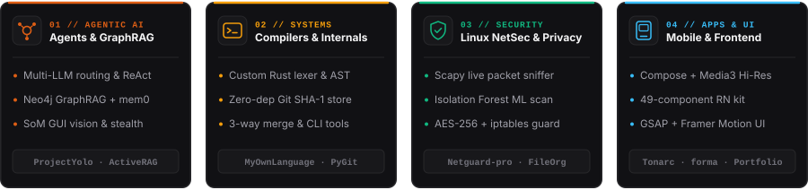
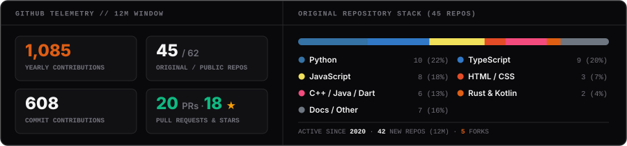

<div align="center">
  <picture>
    <source media="(prefers-color-scheme: dark)" srcset="./assets/banner-dark.svg" />
    <source media="(prefers-color-scheme: light)" srcset="./assets/banner-light.svg" />
    
  </picture>
</div>

<p align="center">
  <a href="https://dharshanbalaji.vercel.app">
    
  </a>
  <a href="https://linkedin.com/in/dharshan-balaji-a72a67308">
    
  </a>
  <a href="mailto:dharshanbalaji83@gmail.com">
    
  </a>
  <a href="https://leetcode.com/u/dharshanbalaji83/">
    
  </a>
  <a href="https://github.com/dharshan-X?tab=followers">
    
  </a>
</p>

<div align="center">
  
</div>

## `01` System Profile

> *Architecting autonomous agent loops, GraphRAG knowledge engines, low-level security daemons, and high-craft interfaces — focused on speed, reliability, and clean system design.*

```toml
# dharshan.toml — Developer Runtime Configuration
[identity]
name       = "Dharshan Balaji"
handle     = "@dharshan-X"
location   = "Salem, Tamil Nadu, India"
education  = "B.E. Computer Science & Engineering (2024–2028)"

[engineering.focus]
ai_agents  = ["Autonomous Loops", "Neo4j GraphRAG", "SoM GUI Vision", "Local LLMs"]
systems    = ["Rust Interpreters", "Clean-Room Git Internals", "Linux NetSec & Scapy"]
apps_ui    = ["Android (Compose / Media3)", "React Native", "React + GSAP / Motion"]

[philosophy]
motto      = "Why use GC when you can manually manage memory and cry?"
loop       = ["brew_coffee", "ship_systems", "break_things", "debug", "repeat"]
```

---

## `02` Core Engineering Domains

<div align="center">
  <picture>
    <source media="(prefers-color-scheme: dark)" srcset="./assets/domains-dark.svg" />
    <source media="(prefers-color-scheme: light)" srcset="./assets/domains-light.svg" />
    
  </picture>
</div>

---

## `03` Featured Artifacts

<table width="100%">
  <tr>
    <td width="50%" valign="top">
      <a href="https://github.com/dharshan-X/ProjectYolo"><b>ProjectYolo</b></a> &nbsp;·&nbsp; <code>Python</code> &nbsp;·&nbsp; <b>★ 3</b>
      <br/><br/>
      Autonomous AI engineering &amp; desktop-control agent featuring a multi-provider LLM router, Set-of-Mark GUI perception, stealth Camoufox browsing, <code>mem0</code> memory, and Textual TUI / Telegram / Discord gateways.
      <br/><br/>
      <sub><code>LiteLLM</code> · <code>mem0</code> · <code>MCP</code> · <code>Playwright</code> · <code>Textual</code></sub>
    </td>
    <td width="50%" valign="top">
      <a href="https://github.com/dharshan-X/Tonarc"><b>Tonarc</b></a> &nbsp;·&nbsp; <code>Kotlin</code> &nbsp;·&nbsp; <b>★ 4</b>
      <br/><br/>
      Privacy-first Android audio player &amp; streaming client built with Jetpack Compose, Media3, and Material 3 Expressive — unifying local Hi-Res playback, Navidrome/Jellyfin servers, and on-device recommendations.
      <br/><br/>
      <sub><code>Kotlin</code> · <code>Jetpack Compose</code> · <code>Media3</code> · <code>Material 3</code></sub>
    </td>
  </tr>
  <tr>
    <td width="50%" valign="top">
      <a href="https://github.com/dharshan-X/forma"><b>forma</b></a> &nbsp;·&nbsp; <code>TypeScript</code> &nbsp;·&nbsp; <code>Cross-Platform</code>
      <br/><br/>
      React Native UI component collection &amp; interactive playground shipping 49 native components and 34 composed blocks with live source previews and shared code across Android, iOS, and Web.
      <br/><br/>
      <sub><code>TypeScript</code> · <code>React Native</code> · <code>Expo</code> · <code>SVG</code></sub>
    </td>
    <td width="50%" valign="top">
      <a href="https://github.com/dharshan-X/ActiveRag_Model"><b>ActiveRag_Model</b></a> &nbsp;·&nbsp; <code>Python</code> &nbsp;·&nbsp; <code>GraphRAG</code>
      <br/><br/>
      Autonomous ReAct GraphRAG agent unifying vector similarity and multi-hop relational reasoning in a single Neo4j knowledge graph, complete with continuous web/chat learning and a FastAPI v2.0 REST API.
      <br/><br/>
      <sub><code>Neo4j</code> · <code>FastAPI</code> · <code>BM25</code> · <code>SentenceTransformers</code></sub>
    </td>
  </tr>
  <tr>
    <td width="50%" valign="top">
      <a href="https://github.com/dharshan-X/Netguard-pro"><b>Netguard-pro</b></a> &nbsp;·&nbsp; <code>Python</code> &nbsp;·&nbsp; <code>NetSec</code>
      <br/><br/>
      Real-time Linux network security &amp; threat detection engine pairing Scapy live sniffing, Isolation Forest ML anomaly scoring, phishing/dark-web threat feeds, <code>iptables</code> auto-blocking, and a React WebSocket dashboard.
      <br/><br/>
      <sub><code>Scapy</code> · <code>scikit-learn</code> · <code>FastAPI</code> · <code>WebSockets</code></sub>
    </td>
    <td width="50%" valign="top">
      <a href="https://github.com/dharshan-X/MyOwnLanguage"><b>MyOwnLanguage</b></a> &nbsp;·&nbsp; <code>Rust</code> &nbsp;·&nbsp; <code>Language</code>
      <br/><br/>
      Custom programming language implemented from scratch in Rust — featuring indentation-to-brace preprocessing, lexical analysis, recursive-descent parsing, and an AST interpreter.
      <br/><br/>
      <sub><code>Rust</code> · <code>Lexer</code> · <code>Parser</code> · <code>AST Interpreter</code></sub>
    </td>
  </tr>
</table>

<details>
<summary><b>📂 More Engineering Builds &amp; Experiments (PyGit, Smart File Organizer, Interview Copilot, Nemotron70b...)</b></summary>

<br/>

| Repository | Stack | Summary |
| :--- | :--- | :--- |
| [**version-controll (PyGit)**](https://github.com/dharshan-X/version-controll) | `Python` | Clean-room Git internals in zero-dependency Python (2,100+ LOC: SHA-1 object store, index, refs, 3-way merge) |
| [**Smart File Organizer (`hackathon`)**](https://github.com/dharshan-X/hackathon) | `Python` | Privacy-first local file manager powered by Ollama LLMs, Tesseract OCR, perceptual deduplication, and AES-256 encryption |
| [**ai-interview-cracker**](https://github.com/dharshan-X/ai-interview-cracker) | `Python` | Real-time AI interview assistant combining live audio transcription, screen OCR, and local Ollama inference |
| [**Nemotron70b**](https://github.com/dharshan-X/Nemotron70b) | `Python` | Streamlit streaming workbench for NVIDIA Nemotron-70B inference |
| [**Fileai**](https://github.com/dharshan-X/Fileai) | `Python` | Multi-format AI document analyzer supporting PDF, code, CSV, and Markdown via Gemini |
| [**ModernPortfolio**](https://github.com/dharshan-X/ModernPortfolio) | `JavaScript` | Interactive developer portfolio with React, GSAP ScrollTrigger choreography, and live GitHub showcases |
| [**Skylab**](https://github.com/dharshan-X/Skylab) | `TypeScript` | Motion-driven TypeScript + React web product interface with Framer Motion & Tailwind |
| [**Resume**](https://github.com/dharshan-X/Resume) | `TypeScript` | Next.js AI-powered resume & job-description analyzer |

</details>

---

## `04` Tech Stack & Runtime Tooling

<table>
  <tr>
    <td><b>Languages</b></td>
    <td>
      
      
      
      
      
      
      
      
    </td>
  </tr>
  <tr>
    <td><b>AI &amp; Data</b></td>
    <td>
      
      
      
      
      
      
    </td>
  </tr>
  <tr>
    <td><b>Web &amp; Mobile</b></td>
    <td>
      
      
      
      
      
      
      
    </td>
  </tr>
  <tr>
    <td><b>Systems &amp; Infra</b></td>
    <td>
      
      
      
      
      
      
    </td>
  </tr>
</table>

---

## `05` Telemetry & Contribution Activity

<div align="center">
  <picture>
    <source media="(prefers-color-scheme: dark)" srcset="./assets/telemetry-dark.svg" />
    <source media="(prefers-color-scheme: light)" srcset="./assets/telemetry-light.svg" />
    
  </picture>
</div>

<br/>

<div align="center">
  <picture>
    <source media="(prefers-color-scheme: dark)" srcset="https://raw.githubusercontent.com/dharshan-X/dharshan-X/output/github-snake-dark.svg" />
    <source media="(prefers-color-scheme: light)" srcset="https://raw.githubusercontent.com/dharshan-X/dharshan-X/output/github-snake.svg" />
    
  </picture>
</div>

<br/>

<div align="center">
  
  <br/><br/>
  <sub><b>Dharshan Balaji</b> · Salem, Tamil Nadu, India · <a href="https://dharshanbalaji.vercel.app">Portfolio</a> · <a href="https://linkedin.com/in/dharshan-balaji-a72a67308">LinkedIn</a> · <a href="https://leetcode.com/u/dharshanbalaji83/">LeetCode</a> · <a href="mailto:dharshanbalaji83@gmail.com">dharshanbalaji83@gmail.com</a></sub>
</div>
